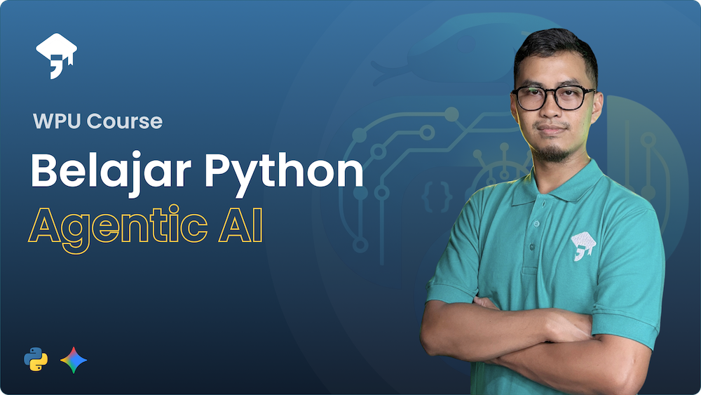

# Mentor Bahasa Inggris Virtual

Sebuah aplikasi Telegram Bot yang dibuat dengan Bahasa Pemrograman Python dan menerapkan Agentic AI.
Repository ini digunakan sebagai materi belajar tentang pengembangan aplikasi yang ditenagai oleh LLM dan AI Agents

Akses kelas di:

[Belajar Python Agentic AI](https://wpucourse.id/course/belajar-python-agentic-ai)

